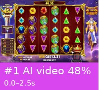
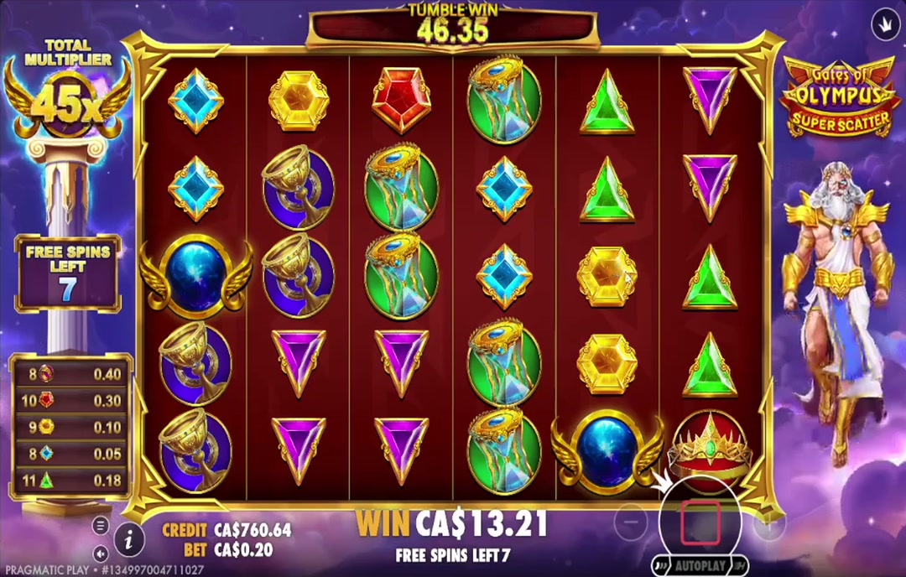
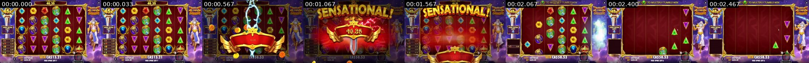

# How this video was made: original_excerpt.mp4

**In one line**: A big-win celebration: lightning-charged plaque, counting amount, slammed title, exit.
**How it was made**: Mixed production: AI-generated video 100%

- 0:02 · horizontal 1568:1000 · 1 shots, 2.5s each on average
- Confidence 48%, based on: tool measurements + claude-agent reviewed 1 shots
- ⚠️ 1 points are uncertain, see “Open questions”

<!--mix-->

# Part one · Breakdown: how this video is built

## What makes it work

- **The hook**: Coins and a lightning strike in the first half second
- Strike + flash at 0.53 s lands the plaque
- Title slam with overshoot at ~1.0 s
- Clean drop-out exit at 1.53 s

## At a glance: picture, packaging, sound

Any short video splits into three layers: the picture, what is laid on top of it (subtitles, styled text, stickers), and the sound. Remake it one layer at a time.

| Layer | In this video | How to make it | Detail |
|---|---|---|---|
| **Picture** (base) | AI-generated video 1 shot | AI in 1 generation | “Remake it yourself” |
| **Packaging** (on top) | subtitle, styled text | add in the editor: subtitles, styled text and stickers by the timeline | “Packaging layer” |
| **Sound** | silent | — | “Sound” |

## Content and structure

- The narrative line below comes from reading each shot; the lines were not transcribed separately, subtitle text is under “Packaging layer”

**Narrative line**

Keep this line in a remake: same order, same job at each step, with the point refilled from your own cases, numbers and material, so it is more than a change of subject.

| Time | Shots | Job | What it says |
|---|---|---|---|
| 0.0–2.5s | #1 | deliver the conclusion | announce a big win |

## Shot list

Picture, Camera and Overlays are what is visible on screen; Made with and Material are the tools' inference, with the basis in the shot-by-shot appendix.

| # | Frames | Time | Length | What it says | Picture | Camera | Overlays | Made with (inferred) | Material (inferred) |
|---|---|---|---|---|---|---|---|---|---|
| 1 |  | 0:00.0 | 2.5s | deliver the conclusion: announce a big win | Win celebration over a dimmed slot board… | static (subject moves) | subtitle, styled text | AI-generated video 48% | AI-generated |

## Cast, scenes and props

- No cast extracted this time (needs AI image reading)

**Scenes**

| Scene | Where | When | Set / light | Shots |
|---|---|---|---|---|
| S1 | slot board | n/a | dimmed board, red-lit celebration | #1 |

**Props / products / logos**

- win plaque (shots #1): counts the amount
- title (shots #1): slams in

## Camera and lighting

- Visual style: glossy 2D game UI motion graphics with additive VFX
- Framing: shot size medium shot 100%; subject is the in-focus region (no face; shot size is an estimate)
- Camera: fixed camera (tripod / mount / on the desk) 100%
- Lighting: coloured ambient light (RGB lights / neon). Key light frame left, three-quarter front, from below (screen / desk bounce / low source); lighting ratio about 1.4:1 (0.5 stops); hard light (sharp shadow edge); colour temperature warm (about 3000–4000K); lower half of the subject is brighter: likely light from below (screen, desk bounce); background slightly soft
- (not live footage: the above describes the light in the picture, for generation prompts, not a shooting plan)
- Grade: vivid, high saturation; high saturation, normal contrast, normal blacks, overall warm

Per-item measurements and image readings (5)

| Aspect | Item | Verdict | Sources |
|---|---|---|---|
| Framing | shot size | medium shot | measured |
| Camera | camera support | fixed camera (tripod / mount / on the desk) | measured |
| Lighting | soft / hard | hard light (sharp shadow edge) | measured |
| Lighting | colour temperature | warm (about 3000–4000K) | measured |
| Grade | colour grade | vivid, high saturation | measured |

- Note: lighting ratio, soft / hard, colour temperature and shot size are measured on the subject's pixels (the face when there is one, otherwise the in-focus region, which is an estimate); platform transcodes crush the shadows, so hardness and fill read conservative; camera angle, light source, catchlight and rim light follow the image readers. Where measurement and readers disagree, both are listed.

## Packaging layer (subtitles / styled text / stickers / sound-effect hits)

- styled text ×3 (large size, yellow fill, multi-colour / gradient, blue fill, thick outline): "46.35", "SENSATIONAL!", "80"
- title ×5: "TUMBLEWIN", "TOAL", "TOTAL MULTIPLI", "OLYMPUS SUPERS", "45x"
- text label ×12: "46.35", "FREE SPINS LEF", "11A", "0.18", "WINCA$58.53", "CREDIT CA$760." …
- counter ×13: "0.40 0.30", "80", "100 0.10", "0.10 0.05", "7", "0.30" …
- Exports: `packaging/overlays.ass`, `packaging/timeline.json` (SRT is the subtitle timeline; ASS carries colour, outline, position and entrance animation, swap in the original font; timeline.json is the full timeline)

text timeline (33 rows)

| Time | Kind | Text | Style | In / out | SFX |
|---|---|---|---|---|---|
| 0.00–1.90s | title | TUMBLEWIN | yellow text, keywords highlighted in purple, line height 3.2% (about 32px) | hard out | — |
| 0.00–1.60s | text label | 46.35 | yellow text, line height 4.8% (about 48px) | hard out | — |
| 0.00–1.60s | title | TOAL | yellow text, keywords highlighted in yellow, line height 3.7% (about 37px) | — | — |
| 0.00–2.50s | title | TOTAL ⏎ MULTIPLIER | yellow text, line height 3.2% (about 32px) | — | — |
| 0.00–2.50s | title | OLYMPUS ⏎ SUPERSCATTER | yellow text, red outline, keywords highlighted in black, line height 5.1% (about 51px) | — | — |
| 0.00–2.50s | text label | FREE SPINS ⏎ LEFT | yellow text, line height 3.3% (about 33px) | — | — |
| 0.00–1.10s | counter | 0.40 ⏎ 0.30 | orange text, line height 3.2% (about 32px) | — | — |
| 0.00–1.10s | counter | 80 | black text, line height 4.3% (about 43px) | shrink out | — |
| 0.00–1.10s | counter | 100 ⏎ 0.10 | brown text, keywords highlighted in black, line height 4.0% (about 40px) | hard out | — |
| 0.00–0.60s | counter | 0.10 ⏎ 0.05 | yellow text, line height 3.5% (about 35px) | — | — |
| 0.00–0.60s | text label | 11A | green text, keywords highlighted in black, line height 4.1% (about 41px) | hard out | — |
| 0.00–1.60s | text label | 0.18 | brown text, line height 3.5% (about 36px) | slide out | — |
| 0.00–2.50s | text label | WINCA$58.53 | white text, line height 6.9% (about 69px) | — | — |
| 0.00–2.10s | text label | CREDIT CA$760.64 | white text, black outline, keywords highlighted in orange, line height 3.5% (about 36px) | shrink out | — |
| 0.00–2.50s | text label | AUTOPLAY | grey text, black outline, line height 3.1% (about 31px) | — | — |
| 0.00–2.50s | text label | PRAGMATICPLAY·#134997004711027 | grey text, line height 2.5% (about 24px) | — | — |
| 0.00–2.50s | title | 45x | black text, gradient, line height 6.9% (about 69px) | — | — |
| 0.50–1.10s | styled text | 46.35 | yellow text, keywords highlighted in red, line height 8.2% (about 82px) | fade in / hard out | — |
| 0.50–1.60s | counter | 7 | white text, line height 5.5% (about 55px) | — | — |
| 0.50–2.10s | text label | BET CA$0.20 | grey text, grey outline, keywords highlighted in yellow, line height 3.5% (about 36px) | hard out | — |
| 0.60–1.40s | counter | 90 ⏎ 0.05 ⏎ 0.18 | yellow text, line height 3.1% (about 31px) | hard in / hard out | — |
| 0.60–1.40s | styled text | 80 | blue text, grey outline, line height 3.2% (about 32px) | hard in / hard out | — |
| 1.00–1.10s | styled text | SENSATIONAL! | yellow text, orange outline, keywords highlighted in black, line height 31.4% (about 314px) | hard in / hard out | — |
| 1.00–1.60s | counter | 0.30 | brown text, line height 3.4% (about 34px) | hard out | — |
| 1.00–1.60s | text label | 11A | black text, keywords highlighted in green, line height 4.0% (about 40px) | hard in | — |
| 1.30–1.90s | counter | 0.10 | orange text, keywords highlighted in black, line height 3.7% (about 37px) | hard in / slide out | — |
| 1.40–2.00s | counter | 0.40 | orange text, line height 3.5% (about 36px) | slide out | — |
| 1.40–1.80s | counter | 0.05 | yellow text, line height 3.5% (about 36px) | hard in | — |
| 1.50–1.60s | counter | 8 | orange text, line height 2.5% (about 24px) | hard in / hard out | — |
| 1.50–1.60s | counter | 10 | red text, bold, line height 3.8% (about 38px) | hard in / hard out | — |
| 1.80–2.50s | counter | 6 | blue text, line height 4.7% (about 47px) | hard in | — |
| 1.90–2.50s | text label | HIT | yellow text, yellow outline, line height 5.5% (about 55px) | — | — |
| 1.90–2.30s | text label | TO MULTIPLY TUMBLE WIN | yellow text, black outline, keywords highlighted in purple, line height 4.7% (about 47px) | shrink out | — |

Remake: burn subtitles and styled text in with `packaging/overlays.ass` (ffmpeg -vf ass=overlays.ass), or rebuild them from timeline.json in CapCut / Remotion; stickers and GIFs need matching assets (meme / GIF libraries), crops are under packaging/.

## Sound

- No audio track

## Open questions

- Shot #1 (0.0–2.5s): AI-generated video at only 48% confidence, runner-up live_action

# Part two · Remake plan

> No video model chosen yet. How the AI shots are grouped, how long one call can be, whether the source can be fed as a reference and how prompts are written all differ by model, so this part is planned for the model you will use: tell the agent which model or platform (Seedance, Kling, Veo, Hailuo…); it looks the model up and runs `rea-video plan <folder> --model <model>` to fill this in.

## Remake it yourself: do it in this order

Copy the method and the rhythm, not the pictures: keep what each part does and fill it with your own content and material.

This is a short AI clip (pets / spectacle / single scene). Do the steps in this order; the detail for each is in the matching subsection below.

1. **Write the content**: write yours in the same 1 steps as the original (narrative line under “Content and structure”)
2. **AI shots**: 1 shots (2 s) to make with a video model. Pick the model first: tell the agent which one and it plans the stretches, inputs and prompts for it (`rea-video plan <folder> --model <model>`)
3. **Edit**: follow the order and lengths in the shot list; the original is a single 2 s take
4. **Subtitles and styled text**: timing and style under “Packaging layer”
5. **Put it together and compare**: hand the shots you made to the agent; `rea-video remake` places them on the original timeline, keeps the original where yours are missing, and renders a side-by-side comparison with the original

### Edit

- Cut in the order and lengths of the shot list
- Rhythm: 0.0 cuts per minute, 2.5s average shot; no live-action shots

## Appendix

### Shot by shot

Each shot has two parts: what is visible on screen, and how the tools infer it was made (with the basis); remake prompts last. Folded by default.

#1 00:00.000–00:02.500 · AI-generated video + code / editor overlays (subtitles, styled text)

**Visible on screen** (check against the frames)
- Picture: Win celebration over a dimmed slot board: coins fly in (0.2-0.45 s); a plaque rises from the bottom (0.47-0.53 s); a vertical lightning bolt strikes it from the top with a flash (0.53-0.63 s); the win amount counts up inside the plaque while the background floods with red light (0.63-0.93 s); a large title slams in from oversized to final scale (0.97-1.1 s); hold with crawling electric arcs (1.1-1.5 s); the whole group drops out downward (1.53-1.73 s) and the board returns.
- Camera / lighting: medium shot; fixed camera (tripod / mount / on the desk); coloured ambient light (RGB lights / neon); key light frame left, three-quarter front; lighting ratio about 1.4:1 (0.5 stops); hard light (sharp shadow edge)
- Text on objects in the scene (not subtitles): FREE SPINS, LEFT, 46.35
- Text track (subtitle/bottom): 0.10 / 0.05 / 90 / 80
- Text track (subtitle/bottom): 11A / 0.18 / 11Δ
- Text track (subtitle/bottom): WINCA$13.25 / CREDIT CA$760.64 / BET CA$0.20 / WINCA$58.53
- Text track (subtitle/bottom): PRAGMATIC PLAY·#134997004711027 / AUTOPLAY / PRAGMATICPLAY·#134997004711027 / AUTO
- [claude-agent review] Slot-game win celebration rendered by the game engine: rigid layered sprites with exact scaling/overshoot easing, additive glow and particle coins, no texture boiling or morphing
- [claude-agent review] Stream compression noise makes it look photographic to pixel statistics; the shapes themselves stay perfectly stable frame to frame

**How it was made, as inferred by the tools** (inferred, not seen)
- Inference: AI-generated video 48%, live action 40%, 3D render 3% (fused_agent)
- Material: AI-generated
- Basis (tool measurements, not necessarily visible to the eye):
  - Photographic texture: noise σ=0.84, 714 colours, 1% flat blocks

- Remake: Source is AI-generated: remake it with a video model; which shots share a call and what it is fed (the source clip, keyframes or first / last frames) depend on the chosen model, see the generation units in the remake plan

### Metadata clues

- Encoder: `Lavf60.16.100`

### Notes

- Deterministic forensics is reliable on motion, whole-frame pan/zoom, rendered texture and 24→30 fps conversion; telling live action from AI from 3D needs image reading (a VLM or an AI assistant's review), and a look at the frames yourself.
- Platform transcoding usually strips metadata; missing metadata proves nothing.
- The full data is in `breakdown.json`; the package for models starts at `VIDEO.md`.
