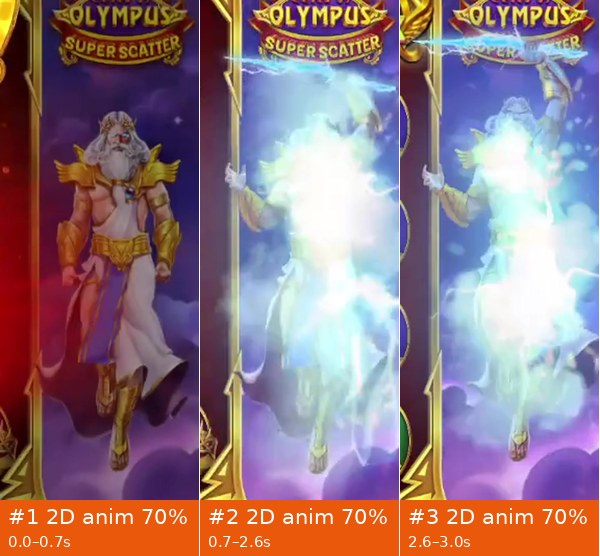
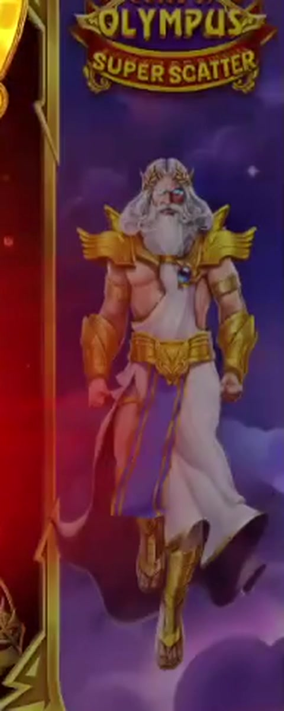
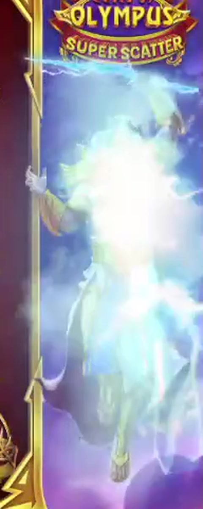
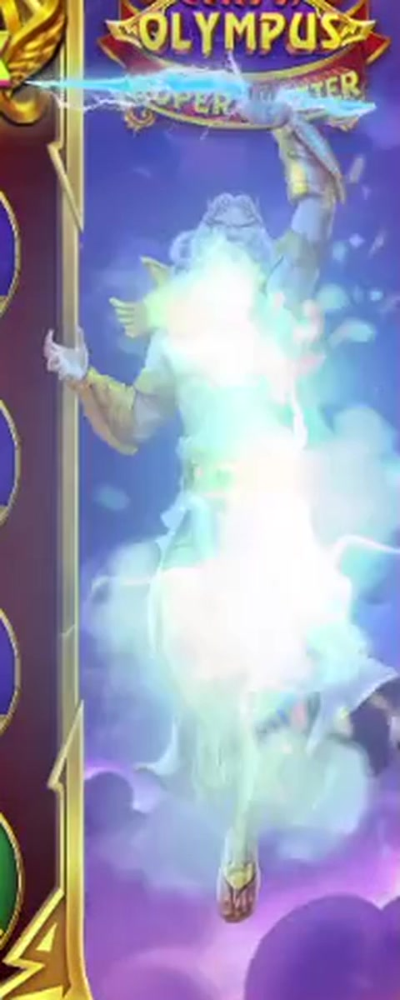
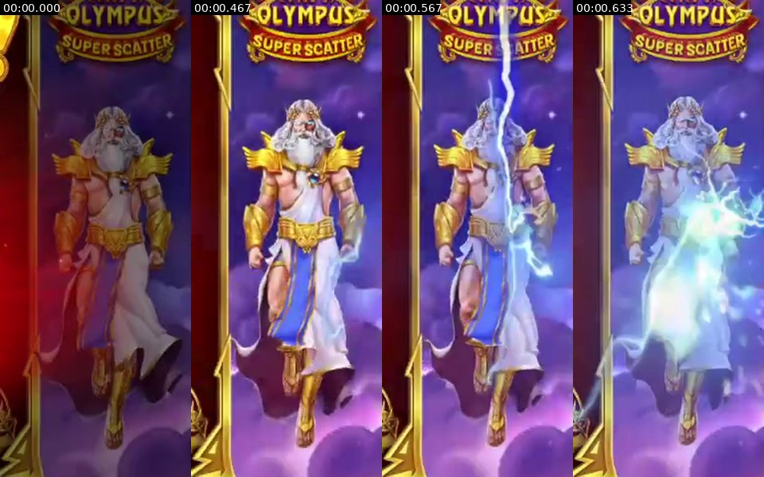
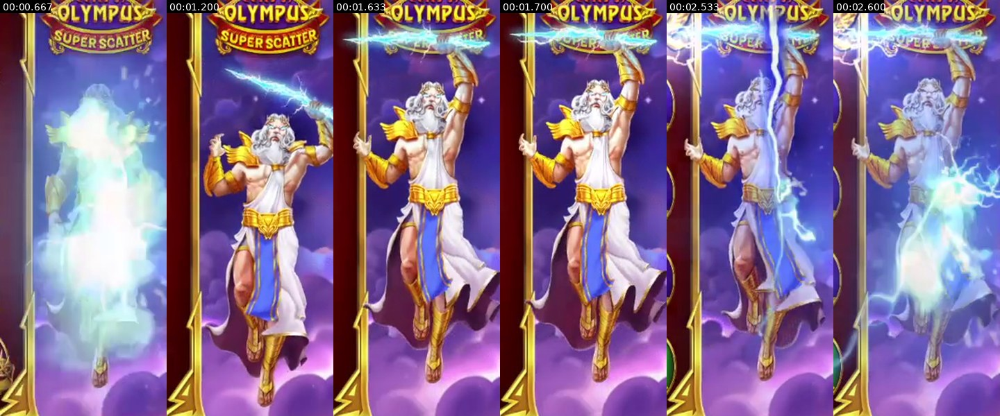
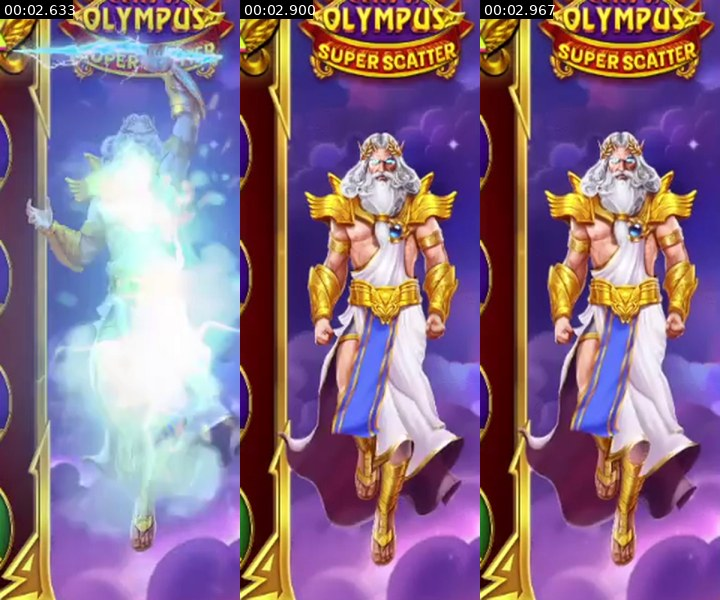

# How this video was made: original_excerpt.mp4

**In one line**: A floating thunder-god mascot is struck by lightning, rises with a bolt held overhead, holds the pose while it crackles, is struck again and returns to idle.
**How it was made**: Mixed production: 2D animation 100% (100% of the duration lacks evidence for live action vs AI, to confirm)

- 0:03 · vertical 480:1200 · 3 shots, 1.0s each on average
- Confidence 70%, based on: tool measurements + claude-agent reviewed 3 shots
- ⚠️ 3 points are uncertain, see “Open questions”

<!--mix-->

# Part one · Breakdown: how this video is built

## What makes it work

- **The hook**: Vertical lightning strike and full-body white flash in the first 0.3 s
- Flash at 0.2-0.6 s masks the idle->power-pose swap so the change feels instantaneous
- Overhead arm thrust settles with overshoot ~1.0-1.4 s, then a long readable hold
- Second strike at ~2.5 s mirrors the first to bookend the loop

## At a glance: picture, packaging, sound

Any short video splits into three layers: the picture, what is laid on top of it (subtitles, styled text, stickers), and the sound. Remake it one layer at a time.

| Layer | In this video | How to make it | Detail |
|---|---|---|---|
| **Picture** (base) | 2D animation 3 shots | AI in 1 generation | “Remake it yourself” |
| **Packaging** (on top) | title, graphic | add in the editor: subtitles, styled text and stickers by the timeline | “Packaging layer” |
| **Sound** | silent | — | “Sound” |

## Content and structure

- The narrative line below comes from reading each shot; the lines were not transcribed separately, subtitle text is under “Packaging layer”

**Narrative line**

Keep this line in a remake: same order, same job at each step, with the point refilled from your own cases, numbers and material, so it is more than a change of subject.

| Time | Shots | Job | What it says |
|---|---|---|---|
| 0.0–0.7s | #1 | grab attention | lightning strike announces a multiplier event |
| 0.7–2.6s | #2 | deliver the conclusion | god channels the bolt to charge the multiplier |
| 2.6–3.0s | #3 | turn | back to idle, ready for next event |

## Shot list

Picture, Camera and Overlays are what is visible on screen; Made with and Material are the tools' inference, with the basis in the shot-by-shot appendix.

| # | Frames | Time | Length | What it says | Picture | Camera | Overlays | Made with (inferred) | Material (inferred) |
|---|---|---|---|---|---|---|---|---|---|
| 1 |  | 0:00.0 | 0.7s | grab attention: lightning strike announces a mul… | Idle pose: character floats centred in a… | smooth move | — | 2D animation 70% | to confirm |
| 2 |  | 0:00.7 | 2.0s | deliver the conclusion: god channels the bolt to… | Power pose: out of the flash the charact… | static (subject moves) | title, graphic | 2D animation 70% | to confirm |
| 3 |  | 0:02.6 | 0.4s | turn: back to idle, ready for next event | Return: white flash dissolves back into … | static (subject moves) | title, graphic | 2D animation 70% | to confirm |

## Cast, scenes and props

| Id | Name | Kind | Look | Role | Voice | Shots |
|---|---|---|---|---|---|---|
| A | thunder god mascot | other | reference mascot (not reproduced in the remake; replaced by an original caricature design) | lead | none | #1–#3 |

**Scenes**

| Scene | Where | When | Set / light | Shots |
|---|---|---|---|---|
| S1 | tall side panel of a slot game | n/a | stormy purple sky with clouds | #1–#3 |

**Props / products / logos**

- lightning bolt (shots #2): held overhead in shot 2, crackles

## Camera and lighting

- Visual style: high-detail painted 2D game art with skeletal animation and additive lightning VFX
- Lighting: stylized painted lighting with additive lightning VFX and white bloom flashes (image reading; pixel measurements in the fold below)

- Note: lighting ratio, soft / hard, colour temperature and shot size are measured on the subject's pixels (the face when there is one, otherwise the in-focus region, which is an estimate); platform transcodes crush the shadows, so hardness and fill read conservative; camera angle, light source, catchlight and rim light follow the image readers. Where measurement and readers disagree, both are listed.

## Packaging layer (subtitles / styled text / stickers / sound-effect hits)

- title ×1: "OLYMPUS"
- text label ×3 (1 of them follow an object): "O", "SUPER SCATER", "JUPER"
- Exports: `packaging/overlays.ass`, `packaging/timeline.json` (SRT is the subtitle timeline; ASS carries colour, outline, position and entrance animation, swap in the original font; timeline.json is the full timeline)

| Time | Kind | Text | Style | In / out | SFX |
|---|---|---|---|---|---|
| 0.00–0.20s | text label | O | yellow text, orange outline, purple box, bold, line height 10.9% (about 131px) | hard out | — |
| 0.30–2.60s | title | OLYMPUS | yellow text, yellow outline, keywords highlighted in yellow, line height 7.0% (about 84px) | hard in | — |
| 0.30–1.50s | text label | SUPER SCATER | orange text, red outline, keywords highlighted in yellow, line height 11.3% (about 135px) | hard in | — |
| 1.50–2.60s | text label · follows an object | JUPER | brown text, orange outline, keywords highlighted in grey, line height 8.8% (about 105px) | hard in | — |

Remake: burn subtitles and styled text in with `packaging/overlays.ass` (ffmpeg -vf ass=overlays.ass), or rebuild them from timeline.json in CapCut / Remotion; stickers and GIFs need matching assets (meme / GIF libraries), crops are under packaging/.

## Sound

- No audio track

## Open questions

- Shot #1 (0.0–0.7s): 2D animation rests on a single image reader (the tools cannot measure this class): 2D animation is easily confused with code-driven motion graphics and AI video, take another look
- Shot #2 (0.7–2.6s): 2D animation rests on a single image reader (the tools cannot measure this class): 2D animation is easily confused with code-driven motion graphics and AI video, take another look
- Shot #3 (2.6–3.0s): 2D animation rests on a single image reader (the tools cannot measure this class): 2D animation is easily confused with code-driven motion graphics and AI video, take another look

# Part two · Remake plan

> No video model chosen yet. How the AI shots are grouped, how long one call can be, whether the source can be fed as a reference and how prompts are written all differ by model, so this part is planned for the model you will use: tell the agent which model or platform (Seedance, Kling, Veo, Hailuo…); it looks the model up and runs `rea-video plan <folder> --model <model>` to fill this in.

## Remake it yourself: do it in this order

Copy the method and the rhythm, not the pictures: keep what each part does and fill it with your own content and material.

This is a 3D / animation. Do the steps in this order; the detail for each is in the matching subsection below.

1. **Write the content**: write yours in the same 3 steps as the original (narrative line under “Content and structure”)
2. **Collect material**: one reference image per character, the same one in every shot: thunder god mascot
3. **AI shots**: 3 shots (3 s) to make with a video model. Pick the model first: tell the agent which one and it plans the stretches, inputs and prompts for it (`rea-video plan <folder> --model <model>`)
4. **Edit**: follow the order and lengths in the shot list; the original has 3 shots at 1.0s each
5. **Subtitles and styled text**: timing and style under “Packaging layer”
6. **Put it together and compare**: hand the shots you made to the agent; `rea-video remake` places them on the original timeline, keeps the original where yours are missing, and renders a side-by-side comparison with the original

### Acting and emotion

In a prompt, describe the visible expression and movement rather than words like “happy” or “sad”, and keep it smaller rather than bigger (strong emotion words tend to give mask faces and forced smiles); get the expression right in the first frame; for shots with lines, make the voice with its delivery first and let the picture act to it. For generated shots the Face and Movement below are already in the generation-unit prompts.

| Shot | Who | Emotion (strength) | Face | Movement / change | Delivery | How to get it |
|---|---|---|---|---|---|---|
| #1 | A (game mascot thunder god) | calm then charged ★key | stern, neutral | idle float, arms down; engulfed by strike flash | none (excerpt muted) | voice first, then drive |
| #2 | A (game mascot thunder god) | triumphant fury (strong) ★key | mouth open, shouting upward | one arm overhead with bolt, other arm out, torso arched, legs trailing | none (excerpt muted) | voice first, then drive |
| #3 | A (game mascot thunder god) | calm (light) | neutral | arms down, float | none (excerpt muted) | voice first, then drive |

- **voice first, then drive**: Speaking: make the voice with its delivery first (TTS with tone tags only where the emotion turns, or a real recording), then drive mouth and face from that audio (Kling Avatar, OmniHuman); with a video model that makes sound itself, put the line and its delivery in the prompt together

### Edit

- Cut in the order and lengths of the shot list
- Approach: no edits: continuous in-game animation; the two detected 'cuts' are white VFX flashes that hide animation-state swaps (idle <-> power pose)
- Rhythm: 40.0 cuts per minute, 1.0s average shot; no live-action shots; transitions cut×2

## Appendix

### Shot by shot

Each shot has two parts: what is visible on screen, and how the tools infer it was made (with the basis); remake prompts last. Folded by default.

#1 00:00.000–00:00.667 · 2D animation

**Visible on screen** (check against the frames)
- Picture: Idle pose: character floats centred in a tall narrow panel, arms hanging, slight bob; at 0.20 s a vertical lightning bolt strikes the figure from above and a white bloom flash fills the body by 0.40-0.66 s (pose swap hidden under the flash).
- Acting: calm then charged · stern, neutral; delivery: none (excerpt muted)
- Text track (title/top): O
- Text track (title/top): OLYMPUS / SUPER SCATER
- [claude-agent review] Painted 2D character with clean, stable silhouette lines; no texture boiling or limb morphing between frames
- [claude-agent review] Body parts move as rigid layers (forearm, upper arm, head, cape panels) - typical Spine/skeletal 2D rig, not frame-by-frame redraw
- [claude-agent review] Frame is a crop of a live-stream capture (slot game rendered in browser, then re-encoded by the stream/clip platform); photographic-looking noise comes from stream compression, not a camera

**How it was made, as inferred by the tools** (inferred, not seen)
- Inference: 2D animation 56%, 3D render 17%, AI-generated video 11% (fused_agent)
- ⚠️ To confirm: 2D animation rests on a single image reader (the tools cannot measure this class): 2D animation is easily confused with code-driven motion graphics and AI video, take another look
- Material: to confirm
- Basis (tool measurements, not necessarily visible to the eye):
  - Photographic texture: noise σ=0.27, 526 colours, 14% flat blocks
  - The whole file is native 30fps and photographic shots carry no 24fps-source duplicate frames (100% of the duration): typical of straight-from-phone footage, generators mostly output 24fps
  - Temporal noise 1.80, 23% of pixels unchanged frame to frame: sensor noise is present, consistent with live action

- Remake: 2D animation: make a character sheet to lock the style, then generate with a video model (see the generation units); for precise lip sync and motion, build an AE / Live2D / Spine project
  - Shot description (from the review; the generation prompts start from it): Rigged 2D character performs: idle float -> lightning strike flash -> raises bolt overhead with other arm wide -> hold with crackle -> second strike flash -> idle

#2 00:00.667–00:02.633 · 2D animation + code / editor overlays (title, static graphics)

**Visible on screen** (check against the frames)
- Picture: Power pose: out of the flash the character rises with the left arm (screen right) thrust straight up gripping a crackling lightning bolt, right arm (screen left) flung out to the side with open clawed hand, head tilted back looking up, beard and cape swinging; arm settles into a held overhead pose from ~1.3 s; electric arcs flicker along the bolt; at ~2.5 s a second vertical bolt strikes and a flash begins.
- Acting: triumphant fury (strong) · mouth open, shouting upward; delivery: none (excerpt muted)
- Text track (title/top): OLYMPUS / SUPSRSCSCATER / COLYMPUS / SUPRSGATER
- Text track (title/top): JUPER / CUPERSATLE
- [claude-agent review] Painted 2D character with clean, stable silhouette lines; no texture boiling or limb morphing between frames
- [claude-agent review] Body parts move as rigid layers (forearm, upper arm, head, cape panels) - typical Spine/skeletal 2D rig, not frame-by-frame redraw
- [claude-agent review] Frame is a crop of a live-stream capture (slot game rendered in browser, then re-encoded by the stream/clip platform); photographic-looking noise comes from stream compression, not a camera

**How it was made, as inferred by the tools** (inferred, not seen)
- Inference: 2D animation 55%, 3D render 16%, AI-generated video 16% (fused_agent)
- ⚠️ To confirm: 2D animation rests on a single image reader (the tools cannot measure this class): 2D animation is easily confused with code-driven motion graphics and AI video, take another look
- Material: to confirm
- Basis (tool measurements, not necessarily visible to the eye):
  - Photographic texture: noise σ=0.33, 774 colours, 13% flat blocks
  - Per-frame sharpness oscillates periodically (period 2 frames, correlation 0.28) with no duplicate frames: frame interpolation / rate conversion, or just the rhythm of a re-encode (transcodes whose platform tags were stripped show it too); not enough on its own to call AI

- Remake: 2D animation: make a character sheet to lock the style, then generate with a video model (see the generation units); for precise lip sync and motion, build an AE / Live2D / Spine project
  - Shot description (from the review; the generation prompts start from it): Rigged 2D character performs: idle float -> lightning strike flash -> raises bolt overhead with other arm wide -> hold with crackle -> second strike flash -> idle

#3 00:02.633–00:03.000 · 2D animation + code / editor overlays (title, static graphics)

**Visible on screen** (check against the frames)
- Picture: Return: white flash dissolves back into the idle pose (arms down, facing camera) at ~2.7-3.0 s.
- Acting: calm (light) · neutral; delivery: none (excerpt muted)
- Text track (title/top): OLYMPUS
- Text track (title/top): CUPER
- [claude-agent review] Painted 2D character with clean, stable silhouette lines; no texture boiling or limb morphing between frames
- [claude-agent review] Body parts move as rigid layers (forearm, upper arm, head, cape panels) - typical Spine/skeletal 2D rig, not frame-by-frame redraw
- [claude-agent review] Frame is a crop of a live-stream capture (slot game rendered in browser, then re-encoded by the stream/clip platform); photographic-looking noise comes from stream compression, not a camera

**How it was made, as inferred by the tools** (inferred, not seen)
- Inference: 2D animation 55%, 3D render 17%, AI-generated video 11% (fused_agent)
- ⚠️ To confirm: 2D animation rests on a single image reader (the tools cannot measure this class): 2D animation is easily confused with code-driven motion graphics and AI video, take another look
- Material: to confirm
- Basis (tool measurements, not necessarily visible to the eye):
  - Photographic texture: noise σ=0.29, 588 colours, 12% flat blocks
  - The whole file is native 30fps and photographic shots carry no 24fps-source duplicate frames (100% of the duration): typical of straight-from-phone footage, generators mostly output 24fps
  - Temporal noise 1.20, 36% of pixels unchanged frame to frame: sensor noise is present, consistent with live action

- Remake: 2D animation: make a character sheet to lock the style, then generate with a video model (see the generation units); for precise lip sync and motion, build an AE / Live2D / Spine project
  - Shot description (from the review; the generation prompts start from it): Rigged 2D character performs: idle float -> lightning strike flash -> raises bolt overhead with other arm wide -> hold with crackle -> second strike flash -> idle

### Metadata clues

- Encoder: `Lavf60.16.100`

### Notes

- Deterministic forensics is reliable on motion, whole-frame pan/zoom, rendered texture and 24→30 fps conversion; telling live action from AI from 3D needs image reading (a VLM or an AI assistant's review), and a look at the frames yourself.
- Platform transcoding usually strips metadata; missing metadata proves nothing.
- The full data is in `breakdown.json`; the package for models starts at `VIDEO.md`.
